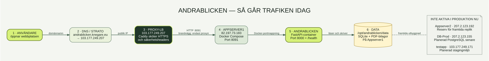
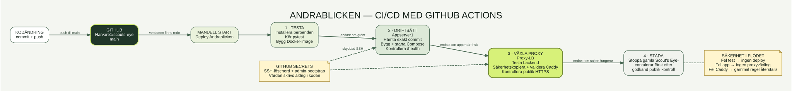

# Andrablicken: servrar och CI/CD

## Infrastruktur

## CI/CD

En mer detaljerad kombinerad karta finns i [andrablicken-arkitektur.svg](andrablicken-arkitektur.svg).

## Serverroller idag

| Server | IP | Roll idag |
|---|---:|---|
| Proxy-LB | `103.177.249.207` | Publik ingång. Caddy sköter HTTPS och skickar trafik till Appserver1. |
| Appserver1 | `82.197.73.183` | Kör Andrablicken med Docker Compose. SQLite och bilagor ligger beständigt här. |
| Appserver2 | `207.2.123.192` | Ingen aktiv Andrablicken-instans. Sparas för senare redundans. |
| DB-Prod | `207.2.123.155` | Inte ansluten. Kan senare användas för PostgreSQL. |
| testapp | `103.177.249.171` | Inte ansluten. Lämplig för en separat stagingmiljö. |

## När någon öppnar webbplatsen

1. DNS för `andrablicken.knegare.eu` pekar på Proxy-LB. Den tidigare adressen `scouts-eye.knegare.eu` omdirigeras permanent hit.
2. Caddy på Proxy-LB avslutar HTTPS och lägger till säkerhetsheaders.
3. Caddy skickar begäran till Appserver1 på port `8091`.
4. Docker mappar port `8091` till FastAPI-containerns port `8000`.
5. Appen läser och skriver SQLite-databasen och PDF-bilagor i `/opt/andrablicken/data`.

## När en version driftsätts

Workflowet **Deploy Andrablicken** startas manuellt från GitHub Actions.

1. GitHub installerar beroenden, kör `pytest` och bygger Docker-imagen.
2. Bara om testerna går igenom hämtar Appserver1 exakt den commit som workflowet gäller.
3. Docker Compose bygger och startar versionen. Workflowet kontrollerar `/health` och startsidan.
4. Proxy-LB kontrollerar backend, säkerhetskopierar den gamla Caddy-regeln, validerar den nya och laddar om Caddy.
5. GitHub kontrollerar den publika HTTPS-sidan.
6. Först därefter stoppas eventuella gamla Scout's Eye-containrar.

GitHub Secrets ger workflowet SSH-åtkomst och det initiala adminlösenordet. Själva hemligheterna finns inte i repositoryt eller diagrammet.

## Viktig nuvarande begränsning

Andrablicken kör en appinstans eftersom SQLite och bilagorna ligger lokalt på Appserver1. Appserver2 kan användas aktivt först efter migrering till exempelvis PostgreSQL på DB-Prod och delad lagring för bilagor.
